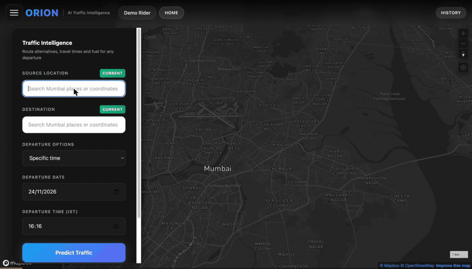
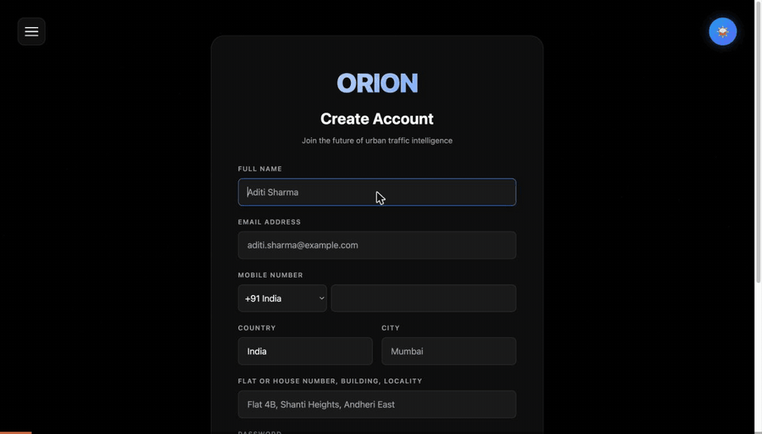
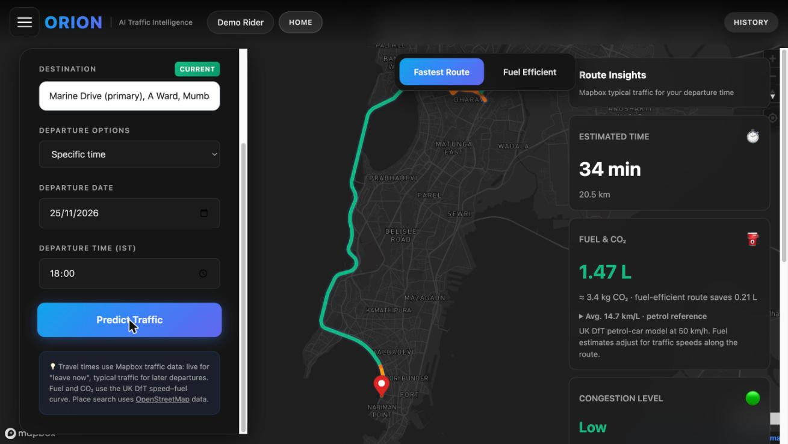
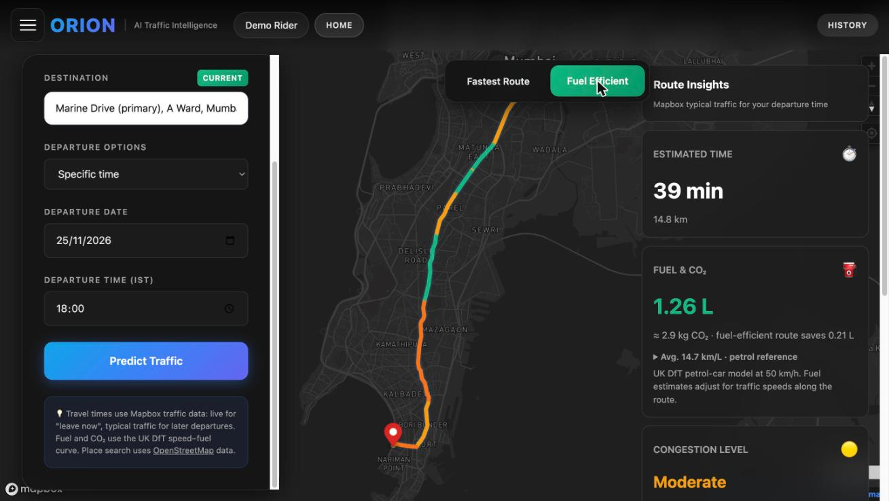
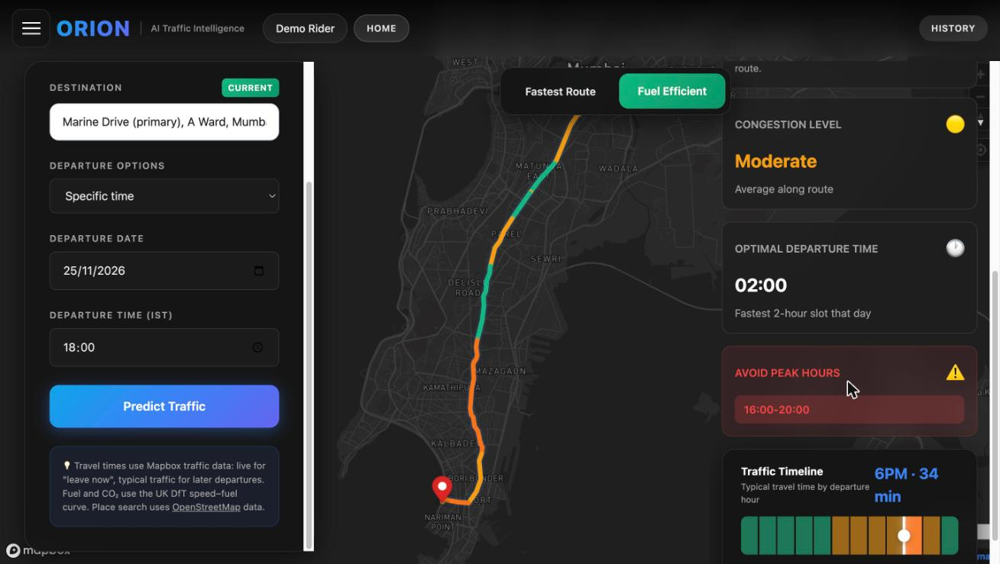
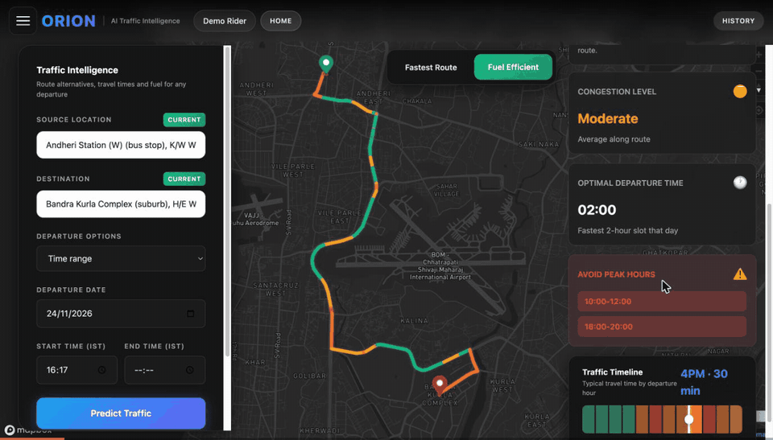
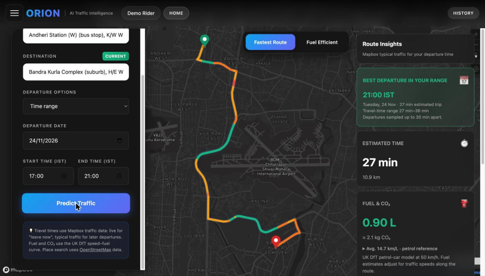
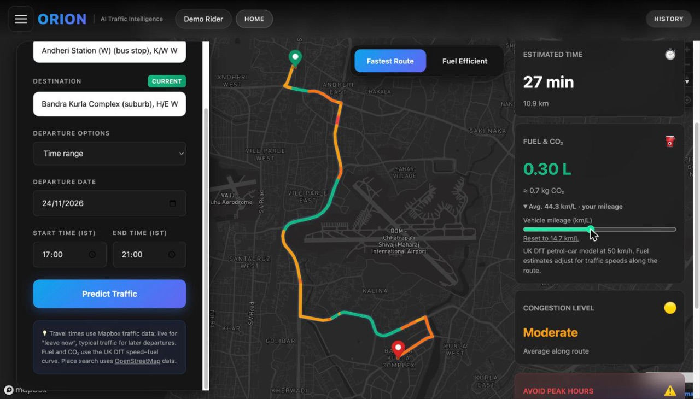
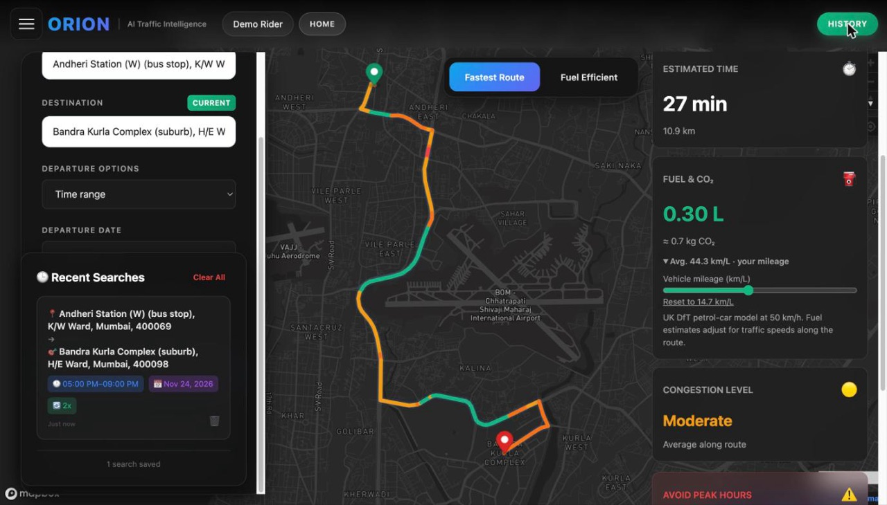
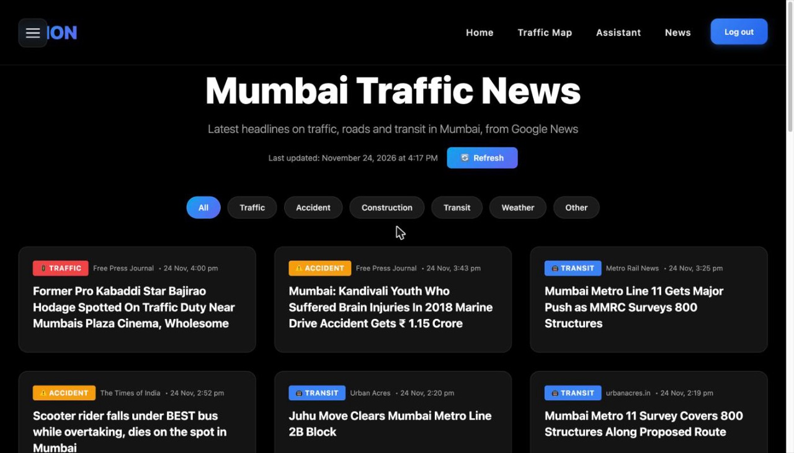

<div align="center">

# ORION

**Mumbai traffic intelligence: which route, when to leave, and what the trip costs in time, fuel and CO₂.**

### [Try it live → orion-xi-lac.vercel.app](https://orion-xi-lac.vercel.app)




</div>

ORION started as a datathon project and was rebuilt into a working product. Every number on screen comes from a real source: Mapbox traffic data, a published fuel-consumption curve, or live news feeds. Nothing is randomly generated, and if a value has no real source, the app does not show it.

## Contents

- [Features](#features)
- [How to use it](#how-to-use-it)
- [Where the numbers come from](#where-the-numbers-come-from)
- [Architecture](#architecture)
- [Run it locally](#run-it-locally)
- [Deploy](#deploy)
- [Limits worth knowing](#limits-worth-knowing)
- [Roadmap](#roadmap)

## Features

- **Route planning for Mumbai:** search landmarks, stations and neighbourhoods, then compare the fastest and the most fuel-efficient route.
- **Traffic-coloured routes:** each stretch of the route is coloured by congestion.
- **Best time to leave:** a 24-hour timeline of typical travel times, the best departure hour, and the peak hours to avoid.
- **Time and date ranges:** give a window such as 5 pm to 9 pm, and ORION samples departures inside it and recommends the quickest.
- **Fuel and CO₂ per trip:** a speed-based petrol model applied to every segment, adjustable to your car's mileage.
- **Search history:** recent trips are saved to your account and can be replayed with one click.
- **Mumbai traffic news:** live headlines about roads, transit, accidents and weather, sorted into categories.

## How to use it

### 1. Create an account

Open the [live app](https://orion-xi-lac.vercel.app), click **Sign up**, and fill in your name, email, mobile number and a password. The password meter shows how strong your password is as you type. Phone numbers default to India (+91) and are stored in international format.



### 2. Plan a trip

Open **Traffic Map**. Type a place in **Source location** and **Destination** (for example "Sion" and "Marine Drive") and pick a suggestion. Choose a departure date and time, then press **Predict Traffic**.

The route appears on the map, coloured by congestion, with the estimated time, distance, fuel and CO₂ on the right.

Switch between **Fastest Route** and **Fuel Efficient** at the top of the map to compare the two. They are often different roads. For Sion to Marine Drive at 6 pm on a weekday, the fastest route takes the Coastal Road along the west coast. The fuel-efficient route cuts through the middle of the city: 5 minutes slower, but 5.7 km shorter and about 14% less fuel.

| Fastest: 34 min, 20.5 km, 1.47 L | Fuel efficient: 39 min, 14.8 km, 1.26 L |
|---|---|
|  |  |

These figures are Mapbox typical-traffic estimates and change with the day and time you pick.

### 3. Find the best time to leave

Scroll the insights panel to see the **optimal departure time** for that day, the **peak hours to avoid**, and the **traffic timeline**, which shows typical travel time for every two-hour slot.



### 4. Compare a window of departures

Set **Departure options** to **Time range** (or **Date range**), choose a start and end, and press **Predict Traffic**. ORION samples departures across the window and highlights the quickest one, along with the range of travel times you can expect.



| Best departure in a range | Adjusting fuel to your car |
|---|---|
|  |  |

### 5. Set your car's mileage

Fuel defaults to a reference petrol car (14.7 km/L at 50 km/h). Open the fuel card and drag **Vehicle mileage** to match your car. Fuel and CO₂ update instantly, without another request.

### 6. Reuse past trips

Click **History** to see recent searches with their departure settings. Click one to plan it again.



### 7. Catch up on traffic news

Open **News** for the latest Mumbai traffic, transit, construction, accident and weather headlines. Filter by category, and click any card to read the full article at its source.



## Where the numbers come from

| Feature | Source |
|---|---|
| Place search | OpenStreetMap, via [Photon](https://github.com/komoot/photon#demo-server) |
| Routes, distance, ETA | Mapbox Directions `driving-traffic`: live traffic for "leave now", typical traffic for later departures |
| Timeline, best departure, ranges | Mapbox typical traffic, sampled across the day or the chosen window |
| Congestion colours | Mapbox congestion labels; for future trips, segment speed against a 60 km/h free-flow reference |
| Fuel and CO₂ | UK DfT TAG data book v1.18, Table A1.3.8 (petrol car speed–fuel curve); 2.31 kg CO₂ per litre |
| News | Google News RSS, filtered to Mumbai mobility stories, with keyword categories |
| Corridor traffic samples | TomTom Traffic Flow, collected every 30 minutes by GitHub Actions (waiting on an API key) |

## Architecture

```
React + Vite ──▶ /api/* ──▶ Express (Vercel Function) ──▶ Mapbox Directions
   (static, Vercel CDN)               │                 ──▶ Google News RSS
                                      ▼
                              MongoDB Atlas  ◀── GitHub Actions: TomTom collector (every 30 min)
```

The frontend and the API ship as one Vercel project on the same domain, so there is no CORS setup and no separate backend host to wake up.

- `client/`: React 19, Vite, Mapbox GL, Framer Motion, Three.js. The map page calls `POST /api/routes/plan` and renders the result.
- `server/`: Express and Mongoose. Route planning (`src/services/routePlanner.ts`), the Mapbox client with a MongoDB cache (`src/services/mapbox.ts`), the fuel model (`src/services/fuel.ts`), news (`src/services/news.ts`), and JWT email-and-password auth with rate limiting.
- `api/index.js`: the Vercel entry point. It wraps the compiled Express app (`server/src/vercel.ts`) and reuses one database connection per instance.
- `ml/`: Mumbai corridor definitions (`corridors.json`) and the TomTom collector (`collect.py`).

## Run it locally

You need Node 22+ and a MongoDB connection string (a free Atlas M0 cluster works).

1. Copy `.env.example` to `.env` in the repo root and fill it in. Both apps read this one file; Vite only exposes `VITE_*` keys to the browser.
2. Start the API:
   ```sh
   cd server && npm install && npm run dev
   ```
3. Start the client in another terminal:
   ```sh
   cd client && npm install && npm run dev
   ```
4. Open http://localhost:5173, sign up, then open **Traffic Map**.

To run the traffic collector by hand (needs `TOMTOM_API_KEY`):

```sh
python3 -m venv ml/.venv && ml/.venv/bin/pip install -r ml/requirements.txt
ml/.venv/bin/python ml/collect.py
```

**Tests:** run `npm test` in `server/` and in `client/`, and `python3 ml/test_collect.py`. CI runs all three on every push.

## Deploy

ORION deploys as a single Vercel project, configured in `vercel.json`. The build compiles the server and the client. Vercel serves `client/dist` as static files and routes `/api/*` and `/health` to the Express function.

```sh
npm i -g vercel
vercel link            # once
vercel env add ...     # MONGO_URI, JWT_SECRET, MAPBOX_TOKEN, VITE_MAPBOX_TOKEN, and VITE_API_URL=/api
vercel deploy --prod
```

## Limits worth knowing

- Mapbox's `duration` for future departures is unreliable in Mumbai, so ORION uses `duration_typical` for anything after "leave now".
- The fuel model is a UK petrol-car curve, with a reference of about 14.7 km/L at 50 km/h. Set your own mileage to scale it. CO₂ uses the petrol emissions factor.
- Time ranges sample departures up to 30, 60 or 120 minutes apart, depending on the window's length, and recommend the quickest sample.
- Google News RSS allows personal, non-commercial feed-reader use. That's fine for a portfolio project; check the terms again before any commercial use.
- Free tiers: TomTom allows 2,500 flow requests a day (the collector uses about 1,900), and GitHub pauses scheduled workflows after 60 days without repository activity.

## Roadmap

Progress is tracked in [`PLAN.md`](PLAN.md).

- **ATLAS assistant:** a chat assistant (Gemini) that can call the route planner as a tool.
- **AI news summaries:** short summaries of each headline.
- **Corridor heatmaps and a custom model:** trained on the collected TomTom data and compared against a simple baseline.
